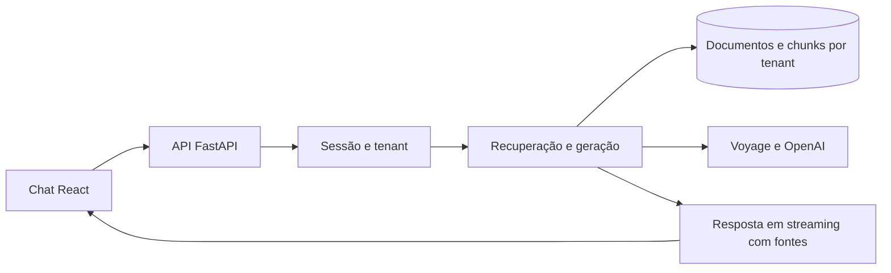

# Sensus IA

Aplicação de perguntas e respostas sobre documentos, com chat web, ingestão de arquivos e organização da base por tenant. O backend recupera trechos relevantes e, quando configurado com um provedor de geração, transmite a resposta por streaming com as fontes utilizadas.

O projeto é desenvolvido como um produto RAG genérico: a mesma aplicação atende organizações com bases próprias. A API, o chat, os fluxos de identidade e a configuração versionada de IA já estão implementados; a demonstração local e o modo com provedores reais têm comportamentos diferentes, descritos abaixo.

## Funcionalidades

- Chat com streaming, indicação de fontes, feedback e restauração da conversa.
- Upload de documentos, extração de conteúdo e chunking estrutural.
- Recuperação híbrida, embeddings Voyage e reranking configurável.
- Organizações e papéis `admin`/`member`, com contexto de tenant derivado da sessão.
- Cadastro com confirmação de e-mail, login, convites, logout e redefinição de senha.
- Configuração de IA por organização, com versões e reativação de uma versão anterior.
- Harness para medir recuperação e respostas sem fundamento usando um corpus público de referência.

## Tecnologias e arquitetura

| Camada       | Tecnologias                                                     |
| ------------ | --------------------------------------------------------------- |
| Interface    | React, TypeScript, Vite                                         |
| API          | Python 3.12, FastAPI, Uvicorn                                   |
| Persistência | PostgreSQL, pgvector, psycopg e RLS                             |
| IA           | Voyage para embeddings/reranking; OpenAI para geração           |
| Identidade   | Cookies de sessão assinados, senhas Argon2 e links de uso único |
| Qualidade    | pytest, Ruff, mypy, Vitest e Testing Library                    |



No desenvolvimento, o Vite encaminha `/api` para a API em `localhost:8001`, mantendo as chamadas no mesmo origin do navegador. A organização vem da identidade autenticada, não de um identificador de tenant enviado livremente pelo cliente.

## Instalação

Requisitos: Git, Python 3.12, `uv`, Node.js 24.x e npm. O modo local de demonstração não exige banco nem chaves de IA.

```sh
git clone https://github.com/NicolasLimao/sensus-ia-publico.git
cd sensus-ia-publico
```

### Terminal 1 — API

Na raiz clonada:

```sh
cd api
uv sync --frozen
cp .env.example .env
uv run python -c "import secrets; print(secrets.token_urlsafe(48))"
```

Copie o valor gerado para `SENSUS_SESSION_SECRET` no `.env`. Mantenha `SENSUS_SESSION_COOKIE_SECURE=false` somente no desenvolvimento HTTP local. Depois execute:

```sh
uv run uvicorn --factory sensus_api.app:create_app --reload --port 8001
```

API: **http://localhost:8001**. Documentação interativa: **http://localhost:8001/docs**.

### Terminal 2 — interface

Em outro terminal, partindo da raiz clonada:

```sh
cd web
npm ci
npm run dev
```

Abra **http://localhost:5173**.

### Primeiro acesso local

1. Solicite a criação de uma organização pela tela de cadastro.
2. Sem SMTP configurado, o e-mail de confirmação aparece no log da API. Abra o link de confirmação no navegador para concluir o cadastro.
3. Entre com o usuário criado e explore o chat e os recursos administrativos.
4. Use documentos de exemplo próprios para experimentar a ingestão. Convites e redefinições de senha também usam links do log nesse modo local.

Sem banco e Voyage configurados, documentos, usuários e configurações usam armazenamento em memória e embeddings de teste; os dados desaparecem ao reiniciar. **Sem geração configurada, o chat usa respostas fixas de demonstração.** Esse modo serve para explorar a interface e os fluxos, sem comprovar recuperação semântica ou qualidade de respostas.

## Configuração com serviços reais

O exemplo completo está em [api/.env.example](api/.env.example).

| Variável                                       | Finalidade                                                   |
| ---------------------------------------------- | ------------------------------------------------------------ |
| `SENSUS_SESSION_SECRET`                        | Segredo de assinatura da sessão                              |
| `SENSUS_DATABASE_URL`                          | Conexão administrativa para migração e configuração do banco |
| `SENSUS_APP_DATABASE_URL`                      | Conexão da aplicação com papel restrito, sem `BYPASSRLS`     |
| `SENSUS_VOYAGE_API_KEY`                        | Embeddings e reranking                                       |
| `SENSUS_OPENAI_API_KEY`                        | Geração de respostas                                         |
| `SENSUS_GENERATION_MODEL`                      | Modelo padrão, compatível com a lista permitida              |
| `SENSUS_ALLOWED_GENERATION_MODELS`             | Modelos selecionáveis na configuração por organização        |
| `SENSUS_SMTP_HOST`                             | Ativa envio real de e-mails                                  |
| `SENSUS_EMAIL_FROM` / `SENSUS_PUBLIC_BASE_URL` | Remetente e origem dos links, obrigatórios com SMTP          |

Com a conexão administrativa configurada no `.env`, aplique as migrações a partir de `api/`:

```sh
uv run python -m sensus_rag.migrate
```

Defina a senha do papel `sensus_app` fora do SQL versionado e configure `SENSUS_APP_DATABASE_URL` com esse papel. A conexão administrativa pode ignorar RLS; ela não substitui o papel restrito de execução. No pooler do Supabase, o usuário também recebe o sufixo do projeto. Consulte [docs/SDD.md](docs/SDD.md) para os detalhes do isolamento e das migrações.

O pipeline persistido requer banco e Voyage. A geração é ativada pela chave OpenAI e pelo modelo; configurar geração sem persistência não transforma o armazenamento em memória em banco durável.

Na hospedagem, use HTTPS e cookies Secure, configure SMTP e os links públicos e sirva a SPA com fallback para `index.html`, incluindo `/confirmar`, `/convite` e `/redefinir`. Sem SMTP, os links vão para o log em vez da caixa de entrada.

## Estrutura

```text
api/src/sensus_api/   rotas, identidade, configuração e montagem da aplicação
api/src/sensus_rag/   ingestão, chunking, embeddings, recuperação e geração
api/migrations/      esquema, RLS e evolução dos fluxos de identidade
api/tests/           testes unitários, contrato e integração
api/evals/           corpus público, datasets e instruções de medição
web/src/             componentes React, cliente da API e estado do chat
docs/SDD.md          arquitetura, decisões e evolução do produto
```

## Testes e qualidade

Na pasta `api/`:

```sh
uv run ruff check .
uv run ruff format --check .
uv run mypy src tests
uv run pytest -q
```

Na pasta `web/`:

```sh
npm run lint
npm run typecheck
npm test
npm run build
```

A suíte Python padrão exclui os testes reais marcados como `contract` e `integration`. Eles exigem provedores ou banco configurados e podem ser executados explicitamente com `uv run pytest -m contract` e `uv run pytest -m integration`. Os testes de RLS também exigem a conexão do papel restrito.

O [harness de avaliação](api/evals/README.md) usa documentos públicos como referência de regressão; seus resultados não são uma nota de qualidade para uma base de cliente.

## Estado e limitações

O projeto está em desenvolvimento. Billing, planos e canais adicionais não fazem parte da entrega atual. As funcionalidades implementadas, decisões e pendências estão no [SDD](docs/SDD.md).

A base documental e o provedor influenciam as respostas; referências e testes automatizados não garantem ausência de erros de geração. No Windows, o uso assíncrono de psycopg exige atenção ao event loop; o caminho da API com banco real sob Uvicorn ainda precisa de validação nesse sistema. Migrações e testes possuem tratamento específico, descrito no SDD.

## Documentação

- [Arquitetura, dados e evolução](docs/SDD.md)
- [Interface web](web/README.md)
- [Avaliação e corpus de referência](api/evals/README.md)
- [Configuração de ambiente](api/.env.example)
- [Dados locais e política da edição pública](PUBLICATION.md)

Desenvolvido por [NicolasLimao](https://github.com/NicolasLimao).
