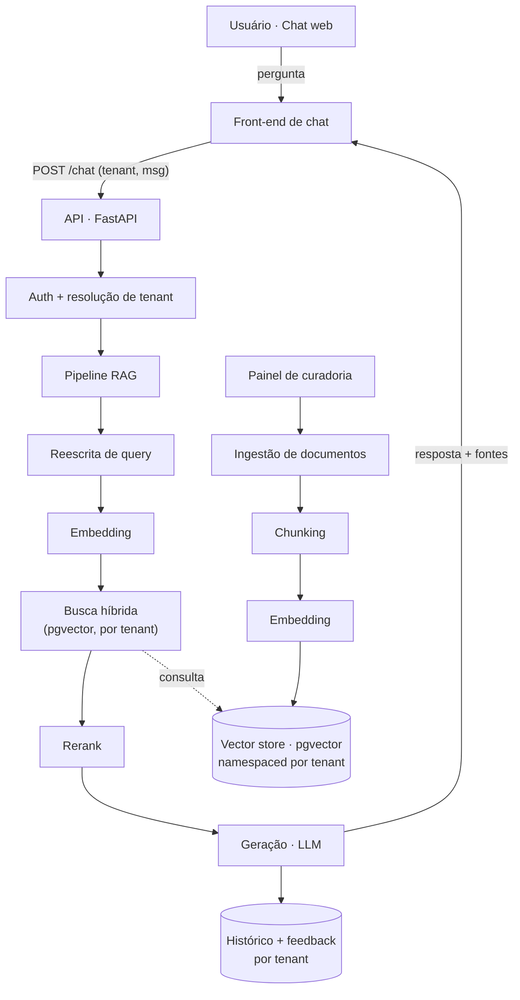

# Sensus IA — Software Design Document (SDD)

> Documento de design do produto. Vivo — evolui conforme cada fatia é desenhada. Estado atual: **fatias 1, 2a e 2b** (chat web, ingestão e recuperação híbrida medível, geração fundamentada com recusa medida) e **fatias 3a–3f** (identidade e isolamento por tenant, invalidação de sessão, convites, reset de senha, convite por e-mail e confirmação de e-mail no cadastro) implementadas. O chat responde a partir dos documentos do tenant; o upstream de demonstração continua existindo, mas só sobe quando a geração não está configurada.

## 1. Visão

Assistente de IA que entende os documentos do cliente e responde por chat, com respostas fundamentadas e citação de fonte. Multi-tenant: cada cliente sobe sua própria base e ganha um especialista naquele conteúdo.

### Objetivos
- Respostas **fundamentadas na base** (RAG), com fontes citadas; recusa honesta quando não há base.
- **Traga seus documentos** — ingestão self-service por tenant.
- **Chat web** como interface principal.
- **Isolamento por tenant** garantido no design.
- **Qualidade mensurável** — harness de avaliação desde cedo.

### Não-objetivos (por ora)
- Fine-tuning de modelos (RAG resolve o alvo inicial).
- Canais além do chat web (Slack/Teams/API) — depois.
- Billing/planos — fatia posterior.

## 2. Arquitetura (alvo)



### Componentes
- **Front-end de chat** — UI de conversa, histórico, citação de fontes. *(1ª fatia)*
- **API (FastAPI)** — autenticação, resolução de tenant, orquestração RAG, ingestão.
- **Pipeline RAG** — reescrita de query → busca híbrida (por tenant) → rerank → geração.
- **Ingestão** — upload → extração (texto/OCR) → chunking → embedding → vector store.
- **Vector store** — pgvector (Supabase) como candidato principal, com dados **namespaced por tenant**.
- **Painel de curadoria** — métricas, gaps da base, gestão de documentos e config.
- **Harness de avaliação** — dataset + juiz LLM + detecção de instabilidade.

## 3. Modelo de dados (esboço)

- `organizations` — id (uuid), slug, nome. É o tenant: uma empresa com várias pessoas.
- `users` — id (uuid), tenant_id, e-mail único, hash argon2id da senha, papel (`admin`/`member`),
  `session_epoch` (contador de geração de sessão, incrementado no logout — fatia 3b —
  e também no reset de senha — fatia 3d).
  Uma pessoa pertence a UMA organização, então o papel mora no próprio usuário — não há
  tabela de associação nem seletor de organização na interface.
- `invitations` — id (uuid), tenant_id, `email` (fatia 3e), `token_hash` (sha256 do
  token, único global), `created_by`, `created_at`, `expires_at`, `accepted_at`,
  `accepted_user_id`, `revoked_at`. O estado é **derivado dos carimbos**, sem coluna
  `status`: pendente é `accepted_at is null and revoked_at is null and expires_at >
  now()`. Tem RLS ligada (fatia 3c).
  O `email` é **nullable de propósito**: as linhas históricas (aceitas, revogadas) não
  têm endereço, e um `not null` obrigaria a inventar valor para elas. Quem garante que
  todo convite novo tem endereço é a borda, não uma restrição que mentiria sobre o
  passado — e a migração 008 **revogou os pendentes sem e-mail**, para não sobrar no
  código um ramo "convite antigo, sem vínculo", que é o modo inseguro que a 3e existe
  para matar.
- `password_resets` — id (uuid), user_id, `token_hash` (sha256, único global),
  `created_at`, `expires_at`, `used_at`, `superseded_at`. Estado **derivado dos
  carimbos**, como o convite. É a **única tabela sem `tenant_id` e sem policy** (fatia
  3d): as três rotas do reset são anônimas, então não existe lado com tenant a proteger,
  e uma policy que nunca casa pareceria proteção sem ter teste que a exercitasse. Em vez
  disso, RLS ligada e **nenhum `grant` para `sensus_app`** — a tabela é inalcançável pela
  aplicação, e só três funções `security definer` a tocam. O teste de integração prova o
  contrário do costume: `select` direto pela conexão da aplicação é recusado.
- `pending_signups` — id (uuid), `organization_name`, `email`, `token_hash` (sha256,
  único global), `created_at`, `expires_at`, `consumed_at`, `superseded_at` (fatia 3f).
  Estado **derivado dos carimbos**, como o convite e o reset. É o cadastro *antes* de
  existir cadastro: enquanto a linha está aqui, não há organização nem usuário — e é
  isso que permite ao `POST /auth/signup` responder 202 genérico, porque não há índice
  único a delatar o endereço.
  **Sem `user_id`** (não há conta a referenciar) e **sem `tenant_id`** (o tenant ainda
  não existe). A pendência é criada **mesmo quando o endereço já tem conta**: sem linha
  não haveria sobre o que aplicar o freio, e a rota anônima viraria amplificador de
  e-mail contra um endereço conhecido.
- `ai_configs` — id (uuid), tenant_id, `version` (por tenant), `briefing`,
  `generation_model`, `generation_top_k`, `max_context_chars`, `suggestions` (text[]),
  `created_at`, `created_by`, `is_active` (fatia 4a). Versões são **imutáveis**: salvar
  cria a seguinte e a ativa; rollback é ativar uma anterior. RLS ligada, policy por
  tenant, e **sem `delete`** no grant — histórico é o que dá sentido ao rollback.
  `is_active` é booleano com **índice único parcial** (`where is_active`), e não carimbo
  derivado como nas tabelas de convite/reset/cadastro: aquelas derivam estados
  **terminais**, e "ativa" não é terminal — vai e volta.
- `documents` — id, tenant_id, nome, tipo, texto cru (fonte durável), status.
- `chunks` — id, tenant_id, document_id, conteúdo, embedding, metadata (seção, índice, tipo).
- `conversations` / `messages` — id, tenant_id, user_id (pseudonimizado), papel, conteúdo, fontes, timestamp.
- `feedback` — message_id, sinal (👍/👎), motivo.

Regra transversal: **todo dado carrega `tenant_id`**; toda consulta filtra por tenant.
Desde a
fatia 3a isso deixou de ser "idealmente com RLS": `documents`, `chunks`, `users` e —
desde a 3c — `invitations` têm policy de RLS ligada, o `tenant_id` é `uuid` com chave
estrangeira para `organizations`, e a aplicação conecta com o papel `sensus_app`, que
**não** tem `BYPASSRLS`. As exceções são `password_resets` (3d) e `pending_signups`
(3f), e elas provam a regra: o que as protege não é escopo de tenant — é serem
inalcançáveis fora das frestas. Nenhuma das duas tem policy ou `grant`, e na segunda a
razão é ainda mais forte: no instante do pedido o tenant **não existe**, então não há
escopo a que pertencer.

> Na fatia 1 o histórico vive em memória, por trás de um `ConversationStore` (Protocol). A persistência real entra com a ingestão (fatia 2) sem mexer nas rotas.

## 3.1 Contrato HTTP (`/api/v1`) — fatia 1

- ~~`POST /session`~~ — **morreu na fatia 3a**. Não existe mais sessão anônima: o cookie sai do
  login, da confirmação de cadastro (3f — até então saía do próprio cadastro), do aceite de
  convite ou do reset, e as sugestões da tela vazia passaram para `GET /auth/me`. As sugestões
  continuam vindo da config do servidor, nunca do código do front: sugestão boa é específica da
  base, e base é do cliente.
- `POST /chat` · `{"message": "..."}` → `text/event-stream`:

```
event: stage    {"stage":"retrieving"}          # → "generating" (só estas duas; "reranking" segue reservado no Literal)
event: token    {"text":"..."}
event: sources  {"sources":[{"id":"…","excerpt":"…","document":"cdc.md","score":0.31}]}
event: done     {"message_id":"…","chunks_used":5,"score":0.31,"elapsed_ms":5845}
event: error    {"code":"upstream_timeout","message":"…"}
```

- `GET /conversation` → restaura a thread da sessão.
- `POST /messages/{id}/feedback` · `{"rating":"up"|"down"}` → 204.

**Decisões embutidas no contrato:**

- `document` nasceu `null` na fatia 1, por não haver ingestão ainda. **Desde a fatia 2b ele vem preenchido** com o nome do documento que a recuperação devolve — a UI melhorou sem que o contrato precisasse de versão, que era exatamente a aposta.
- Resposta sem fundamento é um `done` normal com `chunks_used: 0`, **não** um `error`: tratá-la como falha seria dizer que o sistema errou quando ele acertou ao recusar.
- Erro do upstream não atravessa. Pode carregar stack, nome de tabela ou nome de cliente; vira um código do Sensus (`upstream_timeout`, `service_unavailable`, `bad_request`) e o original fica só no log do servidor.
- Log sem conteúdo: registra tamanho e latência, nunca o texto da mensagem — é PII do usuário final.

### 3.1.1 Contrato HTTP (`/api/v1`) — fatia 2a (ingestão e recuperação)

Todas as rotas abaixo exigem sessão e leem o tenant do `Principal` — nunca de cabeçalho.
Até a 2a o tenant vinha de um cabeçalho que o cliente escolhia; a 3a fechou essa brecha
(seção 6). Ler é de toda a organização; escrever documento exige papel `admin`.

- `POST /documents` · multipart `file` → `201` `{"document_id":"…","name":"…","chunk_count":N}`. Extrai, faz chunking, gera embedding e grava; erros do pipeline viram `400`/`413`/`415`/`503` (ver abaixo).
- `GET /documents` → `200` `{"documents":[{"id":"…","name":"…","chunk_count":N,"created_at":"…"}]}`.
- `DELETE /documents/{document_id}` → `204`; documento de outro tenant, inexistente **ou com id malformado** é indistinguível e responde `404 {"code":"not_found","message":"…"}` — de propósito, não é bug. Id que não é UUID é "não encontrado", nunca `503`: o duplo em memória e o Postgres respondem igual, e `tests/rag/test_repository_contract.py` cobra isso dos dois.
- `POST /search` · `{"question":"…","top_k":5}` → `200` `{"results":[{"chunk_id":"…","document_id":"…","document_name":"…","excerpt":"…","score":0.31,"semantic_rank":1,"lexical_rank":3}]}`. É a rota que o harness de medição e a depuração usam. `semantic_rank`/`lexical_rank` são a posição do trecho em cada perna da busca (`null` quando aquela perna não o devolveu) — diagnóstico exigido pela spec §3.2: sem eles, uma perna morta (índice lexical vazio, dimensão de vetor errada) é indistinguível de relevância baixa dentro do score fundido, e a medição registra uma linha de base que parece válida e não é.

**Tradução de erros do pipeline** (`sensus_api/rag_errors.py`): `unsupported_document` → `415`, `empty_document` → `400`, `document_too_large` → `413`, `service_unavailable` → `503` (embedding ou repositório indisponível). A mensagem exibida nunca carrega detalhe interno do provedor ou do banco — só o código e uma frase fixa.

### 3.1.2 Geração (`POST /chat`) — fatia 2b

O `DemoUpstream` sai; entra o `RagUpstream`, **em processo**. A fatia 1 supôs que o
upstream seria um serviço HTTP remoto; a 2b decide que não é, e a única chamada de rede
que sobra é a do provedor de geração.

Desde a **fatia 4a**, modelo, `top_k`, teto de contexto e briefing não são mais de
processo: o `RagUpstream` resolve a config do tenant na primeira linha de cada
requisição, e o que era variável de ambiente virou **default** de quem nunca configurou.
O `AnswerGenerator.generate` recebe um `GenerationConfig` por chamada — uma instância do
gerador serve todos os tenants.

O contrato SSE não muda de forma. Muda o que ele carrega:

- **`document` deixa de ser `null`** — a recuperação tem o nome do documento.
- **`reranking` não é emitido.** O rerank passou a existir (fatia própria, medida em
  2026-09-05 — ver seção 5), mas o chat não anuncia o estágio: ele acontece dentro da
  recuperação, entre o `retrieving` e o `generating`, e dura menos que a primeira
  chamada de geração. O valor continua no `Literal` para quando valer a pena mostrá-lo.
- **`score` no `done`** é a média do RRF dos trechos citados; `null` na recusa.
- **Recusa** é um `done` com `chunks_used: 0`, `sources: []` e uma frase fixa em `token`
  — nunca um `error`.

**Quem decide que a base não tem a resposta.** O LLM. A busca híbrida nunca devolve lista
vazia: ela ordena e corta no `top_k`, então até para uma pergunta fora do domínio ela
entrega os trechos menos irrelevantes. O prompt manda responder só com os trechos e,
quando eles não sustentam nada, emitir o sentinela `[SEM_FUNDAMENTO]`; o cliente segura
os primeiros caracteres do stream e, se casarem, converte em recusa sem nunca mostrar o
marcador. Limiar de score foi descartado: o score de RRF mede posição no ranking, não
relevância absoluta, e erra justamente no caso perigoso — quando a base tem trechos sobre
o tema que não respondem a pergunta.

A única exceção é a base **vazia**: sem nenhum trecho recuperado, a recusa sai sem gastar
chamada. Isso não é limiar, é ausência.

### 3.1.3 Reset de senha (`/api/v1/auth`) — fatia 3d

Três rotas **anônimas** — quem esqueceu a senha não consegue provar quem é, e é esse o
problema que elas resolvem. O token vai sempre no **corpo**, nunca na query: num path ou
query ele entraria no log de acesso da API, nos proxies do caminho e no `Referer`.

| Rota | Corpo | Resposta |
|---|---|---|
| `POST /auth/forgot-password` | `{email}` | **202 sempre**, com corpo fixo |
| `POST /auth/reset-password/preview` | `{token}` | `{email}` do dono, ou o veredito |
| `POST /auth/reset-password` | `{token, password}` | 200 + cookie de sessão + `{email, role}` |

**O 202 é o desenho inteiro da primeira rota.** Corpo idêntico, status idêntico e tempo
idêntico para conta existente, conta inexistente e pedido freado pelo limite. O tempo sai
de graça porque o e-mail é enviado em `BackgroundTasks`, **depois** da resposta: síncrono,
a espera do SMTP distinguiria os casos e entregaria o que o corpo cala — o mesmo vazamento
que o `burn_time()` do login fecha de outro jeito.

**Vereditos**, derivados dos carimbos por uma função pura, com precedência deliberada —
cada degrau muda o que a tela manda fazer:

| Carimbo | Status | Código | O que a tela diz |
|---|---|---|---|
| não existe | 404 | `reset_not_found` | peça outro link |
| `used_at` | 410 | `reset_used` | faça login: a senha já é outra |
| `superseded_at` | 410 | `reset_superseded` | abra o e-mail mais recente |
| `expires_at <= now` | 410 | `reset_expired` | peça outro link |

**Redefinir incrementa o `session_epoch`** (3b): toda sessão aberta morre, inclusive a de
quem tomou a conta — que é o caso em que a pessoa usa o reset. A conta devolvida já traz a
geração nova, e é com ela que o cookie é assinado; assinar com a antiga produziria uma
sessão que o próprio incremento acabou de invalidar.

O link vale **1 hora** (contra 7 dias do convite: quem pede reset está na tela agora, e o
link vale mais — troca senha e abre sessão) e é de **uso único**. Um pedido novo
**substitui** o anterior, e a substituição acontece *depois* do insert do novo: o
contrário deixaria sem link válido quem fosse freado.

### 3.1.4 Convites (`/api/v1/invites`) — fatia 3e

O convite deixou de ser um link na tela do admin: ele é **mandado por e-mail** ao
endereço convidado, e só aquele endereço entra por ele. Duas rotas exigem `admin`, duas
são **anônimas** — quem foi convidado ainda não tem conta.

| Rota | Corpo | Resposta |
|---|---|---|
| `POST /invites` (admin) | `{email}` | 201 `{id, email, expires_at}` — **sem token** |
| `GET /invites` (admin) | — | `[{id, email, created_at, expires_at}]`, só os pendentes |
| `DELETE /invites/{id}` (admin) | — | 204 sempre, idempotente |
| `POST /invites/preview` | `{token}` | `{organization_name, email, expires_at}` ou o veredito |
| `POST /invites/accept` | `{token, password}` | 201 + cookie de sessão + `{email, role}` |

**O token não aparece em resposta HTTP nenhuma**, e é isso — não a coluna `email` — que
faz o convite provar posse do endereço: quem intercepta um link vê o endereço na própria
tela de aceite e o usaria, então o vínculo sozinho não provaria nada. O que prova é o
link existir **somente** dentro da caixa de entrada.

**A criação recusa com 409 `already_member`** quem já tem conta **nesta** organização — e
só nesta. `find_by_email` é global, porque o login precisa disso; responder 409 sempre que
ela encontra alguém transformaria o painel num oráculo de enumeração entre tenants (o
admin da Acme descobriria quem tem conta na Globex só tentando convidá-lo). Conta em outra
organização segue o caminho normal, e a colisão aparece só no aceite (409 `email_taken`)
— para o dono da caixa, e só para ele, já que é ele quem tem o token. A 3f **manteve**
esse 409 de propósito (§9): ali não há o que esconder de quem já sabe.

**O envio é síncrono**, ao contrário do reset: aqui não há oráculo de tempo a proteger — o
admin está autenticado e foi ele quem digitou o endereço — e ele precisa saber se o
convite saiu. SMTP recusou → **502 `invite_not_sent`**, e o convite é **revogado** (não
apagado: o `insert` já comitou, e revogar deixa rastro da tentativa). Convite criado que
ninguém recebeu é pior que convite que não foi criado.

**Convite novo substitui o pendente do mesmo endereço**, e a substituição vem *antes* do
insert — ao contrário do reset, onde o freio podia abortar o insert depois. Os vereditos
(`invite_not_found`, `invite_used`, `invite_expired`, `invite_revoked`) e a precedência
entre eles continuam os da 3c.

### 3.1.5 Confirmação de e-mail no cadastro (`/api/v1/auth`) — fatia 3f

O cadastro **deixou de criar organização**. Ele virou um pedido; quem cria é o clique no
link que chega na caixa de entrada. A inversão existe para fechar a última enumeração
aberta do produto: sem conta criada na hora, não há índice único para delatar o endereço,
e o 409 `email_taken` dá lugar a um **202 genérico**.

Três rotas **anônimas** — quem se cadastra ainda não tem conta. O token vai sempre no
**corpo**, nunca na query, pela razão da 3d.

| Rota | Corpo | Resposta |
|---|---|---|
| `POST /auth/signup` | `{organization_name, email}` | **202 sempre**, corpo fixo — sem cookie, sem conta |
| `POST /auth/confirm-signup/preview` | `{token}` | `{organization_name, email}` ou o veredito |
| `POST /auth/confirm-signup` | `{token, password}` | 201 + cookie de sessão + `{email, role}` |

**O 202 é idêntico no corpo, no status e no tempo** para endereço livre, endereço com
conta e pedido freado. O tempo sai de graça porque os e-mails saem em `BackgroundTasks`,
depois da resposta — o mesmo desenho do `forgot-password`.

**A senha nasce na confirmação, não no cadastro**, e isso não é UX: é o que mata o
cadastro alheio. Guardar o hash na pendência deixaria A escolher a senha da conta que B
criaria ao clicar num link que A disparou; com a senha na segunda etapa, quem escolhe é
sempre quem tem a caixa de entrada.

**Dois e-mails, e a caixa é que distingue os casos.** Endereço livre recebe o link;
endereço com conta recebe "este endereço já tem conta — entre, ou use esqueci a senha",
**sem link nenhum** (embutir um reset faria de uma rota anônima um disparador de
redefinição para endereços alheios). O segundo é o que tira do beco sem saída quem
esqueceu que já se cadastrou, já que a tela não pode contar.

**O nome da organização não entra em e-mail nenhum.** É texto escolhido por quem digita o
formulário, e o e-mail pode chegar à caixa de outra pessoa — campo controlado por
terceiro entregue a quem não o escreveu. O nome aparece na **tela** de confirmação,
depois do clique, e é para isso que a prévia o devolve.

**Vereditos**, derivados dos carimbos por uma função pura, com a precedência de sempre:

| Carimbo | Status | Código | O que a tela diz |
|---|---|---|---|
| não existe | 404 | `signup_not_found` | peça outro link |
| `consumed_at` | 410 | `signup_used` | faça login |
| `superseded_at` | 410 | `signup_superseded` | abra o e-mail mais recente |
| `expires_at <= now` | 410 | `signup_expired` | cadastre-se de novo |

O link vale **24 h** (entre a 1 h do reset e os 7 dias do convite) e é de uso único;
pedido novo substitui o anterior, **depois** do insert.

**Um caso que as outras fatias não tinham:** o endereço pode ganhar conta entre o pedido e
o clique, se alguém aceitar um convite nesse meio-tempo. A criação levanta `23505`, que
desfaz a transação inteira — **inclusive o consumo** —, e a borda responde `409
email_taken`. Aqui o 409 é legítimo: quem apresenta o token é o dono da caixa, e o fato é
sobre o próprio endereço dele.

**O freio** é de 2 min por endereço, e o mutex mudou de mecanismo em relação à 3d: lá era
a linha do usuário (`select … for update`), e aqui ela pode não existir — o caso normal do
cadastro é justamente esse. Um `pg_advisory_xact_lock` sobre o endereço serializa sem
depender de linha nenhuma.

### 3.1.6 Config de IA por tenant (`/api/v1/ai-config`) — fatia 4a

Tudo que decide **como** o produto responde era global e de processo. Agora é do tenant,
versionado e reversível. Três rotas, **todas exigindo `admin`**:

| Rota | Corpo | Resposta |
|---|---|---|
| `GET /ai-config?limit&offset` | — | `{active, versions[], has_more_versions, allowed_models[]}` |
| `POST /ai-config` | `{briefing, generation_model, generation_top_k, max_context_chars, suggestions}` | 201 com a versão criada; corrida perdida → 409 |
| `POST /ai-config/{id}/activate` | — | 204; inexistente **ou de outra organização** → 404 |

**A política anti-alucinação não é configurável.** As quatro regras e o sentinela
`[SEM_FUNDAMENTO]` ficam no código; o tenant edita um **briefing** que entra depois
delas, dentro de `<contexto-do-cliente>` e seguido da frase que diz qual dos dois
prevalece. O briefing **não fecha o próprio delimitador**: as marcações são removidas
dele antes da montagem (com espaços e em qualquer caixa), porque um briefing começando
por `</contexto-do-cliente>` fecharia a seção por dentro e o resto chegaria com cara de
instrução do sistema — o único mecanismo da fatia caindo com uma linha de texto. Prompt inteiro editável mataria a promessa central do produto por
configuração, sem erro nenhum aparecer — bastaria apagar a regra 2. Validar um prompt
livre (exigir o sentinela no texto) é jogo de gato e rato.

**Sem briefing, o system prompt é byte a byte o de antes da 4a** — a linha de base de
medição de 2026-09-02 continua comparável, e há teste que a guarda.

**`active` vem resolvido**: quem nunca salvou recebe os valores do ambiente. A borda e o
pipeline lidam com uma forma só, e nenhum deles tem ramo "ainda não configurou".

**O modelo sai de uma lista permitida** (`SENSUS_ALLOWED_GENERATION_MODELS`), e a
resposta de recusa **nomeia** os válidos: sem isso a tela só pode dizer "inválido". Texto
livre viraria 4xx do provedor em produção, descoberto pelo usuário final no meio de uma
resposta.

**A config é resolvida a cada pergunta, sem cache.** É uma leitura indexada ao lado de um
embedding, uma busca e uma geração. Cache tem invalidação, e invalidação errada serve a
config velha logo depois de um rollback — o pior momento possível.

**As sugestões da tela vazia saem daqui** e chegam pelo `GET /auth/me`. É a única parte
da config que alcança `member`: ele não vê nem edita `/ai-config`, mas é a tela dele que
as mostra.

**O histórico vem paginado** (`limit` default 20, teto 100; `offset`), e só ele: `active`
é uma linha e é o que quem abre o painel quer editar. O "tem mais?" sai de ler **uma linha
a mais** que o limite, não de um `count(*)` — a tela precisa saber se o botão tem o que
carregar, não de um total exato que ninguém pediu. O painel pede a página seguinte a
partir de **quantas versões já tem**, e assim não precisa conhecer o tamanho da página do
servidor.

**Escrita simultânea é 409, não 500.** São **duas** corridas, e as duas chegam como
`23505`: dois admins salvando no mesmo instante disputam o `unique (tenant_id, version)`,
e dois rollbacks cruzados disputam o `ai_configs_uma_ativa_por_tenant` — a segunda
transação não enxerga a linha que a primeira acabou de ativar, ativa a sua por cima, e o
índice parcial recusa. O adaptador traduz as duas em `ConcurrentConfigWrite`; solta, a
`UniqueViolation` subia crua e a borda dizia "o servidor quebrou" para um caso em que o
banco protegeu o dado. A resposta manda **recarregar** antes de repetir: quem perdeu a
corrida tem na tela um estado que já não vale, e repetir por cima dele desfaria em
silêncio o que a outra pessoa acabou de fazer. Os testes forçam as corridas de verdade —
uma transação escreve e fica aberta, a segunda bloqueia no índice, e só então a primeira
comita; sem a espera pelo bloqueio, o teste provaria o caminho feliz com nome de corrida.
A segunda corrida não estava no registro: foi encontrada ao perguntar se o vizinho de
`create_version` tinha a mesma falha, e medida antes de ser corrigida.

**Ativar não pode ser um `update` único.** `set is_active = (id = %s)` é o que parece
certo e falha: o índice único parcial é verificado linha a linha, e se a linha a ativar
vier antes da que está ativa, as duas ficam `true` por um instante. A troca são dois
comandos dentro da transação do `TenantScope`; o intervalo sem nenhuma ativa é invisível
de fora, por MVCC. Medido no Postgres real antes de a migração 010 ser aplicada.

## 4. Decisões de design

**Fixas:**
- RAG (não fine-tuning) para o alvo inicial.
- Multi-tenant com isolamento por design.
- Config por env; segredos fora do repo/imagem.
- Fonte crua durável dos documentos (re-chunkar sem reprocessar).

**Fechadas na fatia 1:**
- **Front-end:** React + Vite (SPA estática, sem segredo algum no bundle).
- **Identificadores de código em inglês**; docs, comentários e texto de UI em PT-BR.
- **Sessão do navegador:** cookie httpOnly assinado com `user_id` pseudonimizado — nunca em query string.
- **Citação por trecho, não por sentença.** O pipeline recupera N trechos e gera texto corrido; marcar frase↔trecho inventaria uma precisão que não existe. A faixa "Fundamentado em N trechos" afirma só o que o sistema sabe.
- **O score de recuperação não vai para a tela** como confiança. Ele mede similaridade média, não qualidade da resposta: respostas boas medem 0,25–0,48, e exibir "confiança: 32%" faria a UI mentir.
- **Streaming é requisito, não polimento.** A cauda de latência medida chega a 71 s; um chat mudo por 30 s parece quebrado.

**Fechadas na fatia 2a:**
- **Pipeline de RAG em duas fatias:** ingestão + recuperação híbrida (2a, esta) sem geração de resposta; a geração entra separada (2b). Permite medir recall/MRR da recuperação isoladamente, antes de qualquer efeito do LLM de geração se misturar à medição.
- **Supabase como Postgres, via `psycopg` assíncrono** (não o SDK do Supabase) — mesmo banco, acesso direto por SQL parametrizado, pgvector como extensão.
- **Embeddings: Voyage `voyage-4-large`, 1024 dimensões.** `input_type` diferenciado entre ingestão (`document`) e busca (`query`).
- **Fusão por RRF (Reciprocal Rank Fusion)**, não soma ponderada de scores — os scores de busca semântica e lexical não são comparáveis na mesma escala; RRF funde só pelas posições no ranking, sem precisar calibrar peso.
- **Dataset de avaliação ancorado em trecho de texto, não em id de chunk.** Chunking pode mudar (parâmetros, reprocessamento); um trecho de texto continua localizável no documento, um id de chunk vira lixo na primeira reindexação.

**Fechadas na fatia 2b:**
- **Provedor de geração: OpenAI, `gpt-4o-mini`**, por variável de ambiente. Embeddings
  seguem na Voyage — as duas decisões são independentes de propósito.
- **HTTP direto, sem SDK de provedor**, como no `VoyageEmbedder`: com `MockTransport` o
  cliente inteiro é testável sem rede, e trocar de provedor vira trocar um arquivo.
- **Recusa é evento de domínio; a frase é copy do adaptador.** `sensus_rag` não carrega
  texto de interface, e a fatia 4 poderá trocar a frase por tenant sem tocar no pipeline.
- **Sentinela em vez de saída estruturada**, porque streaming é requisito: saída
  estruturada só se conhece quando o JSON fecha, e até lá o chat fica mudo.
- **O que decide o upstream real é a geração configurada, não o banco.**
- **Piso anti-alucinação apenas** — prompt fechado, recusa e medição. Verificação
  pós-geração e limiar de score ficam para quando a medição mostrar necessidade.

**Fechadas na fatia 3a:**
- **Tenant = organização, e uma pessoa pertence a UMA.** O papel (`admin`/`member`) mora no
  próprio usuário: sem pertencer a duas, tabela de associação e seletor de organização seriam
  complexidade paga sem nada em troca. Convidar mais gente é a fatia 3c.
- **Auth próprio, e-mail + senha, com argon2id.** Coerente com o resto do repositório (HTTP
  direto, sem SDK de provedor, testável sem rede). Supabase Auth foi descartado de propósito:
  traria um SDK e um modelo de identidade que não são nossos para dentro do produto.
- **O prazo mora no token, não no cookie.** O token de sessão passou a ser assinado com
  carimbo e a vencer; antes, só o cookie tinha `max_age` — e o cookie é do navegador, que é
  justamente quem não pode ser a autoridade sobre a validade da própria sessão.
- **Isolamento por tabela compartilhada + RLS**, não banco ou schema por tenant. A policy lê
  `nullif(current_setting('sensus.tenant_id', true), '')::uuid`, e a aplicação conecta com o
  papel `sensus_app`, **sem** `BYPASSRLS` — com o `postgres` de antes, a policy seria decoração.
- **`TenantScope` é a porta única para o banco.** Só entrega conexão a quem informa o tenant, e
  já abre a transação com `set_config(..., true)`. A armadilha evitada era `set` de sessão: o
  valor sobreviveria à devolução da conexão ao pool, e a requisição seguinte herdaria o tenant
  da anterior.
- **O papel NÃO entra na policy.** Ele teria de viajar da borda para dentro do `sensus_rag`, que
  é o RAG genérico e não conhece usuário. Papel é checado na borda HTTP; a defesa em
  profundidade, se um dia valer, é dois papéis Postgres com pools distintos.

**Fechadas na fatia 3b:**
- **A geração da sessão mora no usuário, não em um registro de sessões.** Uma coluna, zero
  tabela nova e zero consulta a mais — `require_session` já lia a conta a cada requisição. O
  preço é a granularidade: sair encerra todas as sessões da pessoa. Revogação por dispositivo
  exigiria identificador por sessão, tabela, RLS e expiração, e só se paga quando existir tela
  de "dispositivos conectados". De graça, isto já é o "trocar a senha derruba as sessões" que a
  3d vai precisar.
- **Carimbo de corte foi descartado.** Comparar contra o timestamp que o `itsdangerous` já
  embute evitaria mudar o formato do token, mas o carimbo tem resolução de um segundo: ou um
  token emitido no mesmo segundo do logout sobrevive o prazo inteiro, ou quem sai e entra no
  mesmo segundo nasce inválido. Trocar uma condição de corrida por outra não paga a economia
  de uma migração.

**Fechadas na fatia 3c:**
- **O link do convite É a credencial, e não prova posse de e-mail.** Sem provedor de
  e-mail (3d) não há como provar posse de endereço; prender o convite a um e-mail não
  verificado daria falsa garantia pelo mesmo preço. Quem abre o link escolhe o próprio
  e-mail e a própria senha.
- **Uso único, prazo de 7 dias, revogável antes do uso.** Com o link como credencial, é
  isto que limita o vazamento: o estrago é uma conta, e a pessoa certa percebe porque
  acha o link já usado. 7 dias é o mesmo prazo do token de sessão — um relógio a menos
  no produto.
- **Só o sha256 do token é guardado.** Vazamento do banco não pode entregar convites
  válidos. Argon2 foi descartado de propósito: ele existe para segredo de baixa entropia
  escolhido por gente, e estes são 256 bits gerados por nós. Consequência aceita: o link
  aparece **uma única vez**, na criação.
- **Convite assinado sem estado (`itsdangerous`) foi descartado.** Zero migração e zero
  estado, mas **uso único e revogação exigem estado**: não se "des-emite" um blob
  assinado. A tabela existe por este motivo.
- **Sempre `member`.** `role` no convite seria coluna, seletor e mais uma checagem, e
  faria um link vazado poder valer `admin`. Promover alguém sai com a fatia que tiver
  tela de pessoas.
- **O admin toca a tabela pela RLS; o convidado, por `security definer`.** O admin tem
  tenant — é a situação para a qual a policy existe. Fazer tudo por função `security
  definer`, como em `users`, faria o isolamento de 3 das 5 operações depender de a
  aplicação passar o tenant certo, e a policy viraria decoração nesta tabela. Por isso
  `list_pending` e `revoke` **não** levam `where tenant_id`: um `where` por cima
  esconderia uma policy quebrada, e o teste de leitura cruzada ficaria passando por
  engano.
- **O token viaja no fragmento da URL e no corpo do POST.** O fragmento não é enviado a
  servidor nenhum (fora do log do host estático, do `Referer` e de previews de link); no
  corpo do POST, fica fora da query, do log de acesso da API e dos proxies do caminho. É
  por isso que a prévia é POST e não GET, ao preço de não ser REST puro.
- **O veredito é distinguido** — usado, vencido, revogado e inexistente têm códigos
  diferentes. Não vaza nada: quem tem um token de 256 bits já tem o segredo, e quem não
  tem recebe 404 em tudo. Pelo mesmo motivo não há throttle no token: não há o que
  adivinhar.

**Fechadas na fatia 3d:**
- **SMTP genérico, não a API de um fornecedor.** Serve Resend, SES, Postmark, Mailgun ou o
  servidor do próprio cliente sem trocar código — e num produto multi-tenant o cliente pode
  querer que o e-mail saia do domínio dele. O preço é menos sinal de entrega (sem id de
  mensagem, sem webhook de bounce); quando isso doer, o que muda é **um** adaptador.
- **Sem SMTP configurado, o e-mail vai para o log** — corpo inteiro, link incluído. É o que
  faz o fluxo rodar numa máquina de desenvolvimento sem infraestrutura. Em produção seria
  um sintoma grave, por isso a aplicação avisa no log ao subir.
- **`public_base_url` volta a existir, e é obrigatória quando há SMTP.** A 3c fugiu dela
  deixando o front montar o link do convite (`window.location.origin`), o que elimina o
  erro clássico de apontar para o host errado. O e-mail de reset é montado no **servidor**,
  que não tem `window` — então a variável é inevitável, e recusar subir sem ela põe o
  barulho no lugar certo: um link torto só apareceria na caixa de entrada de quem
  precisava dele.
- **O e-mail sai depois da resposta (`BackgroundTasks`).** Não é desempenho: é o que torna
  o 202 genérico honesto também no relógio (ver §3.1.3).
- **A tabela não tem `tenant_id`, policy nem `grant`.** Primeira do projeto assim, e por
  ausência de lado com tenant, não por descuido — ver §3.
- **O freio do pedido trava a linha do usuário (`select ... for update`).** A lição da 3c —
  "faça o trabalho dentro do `update`" — **não se transporta para o `insert`**: um `update`
  que perde a corrida reavalia seu `where` na linha já travada, mas duas transações que
  avaliam `not exists` veem cada uma o próprio snapshot e **as duas passam**. O freio
  sairia quebrado no único caso para o qual existe. A linha do usuário serve de mutex e já
  existe — nada de tabela nem de lock novo.
- **Prazo de 1 hora, e não os 7 dias do convite.** Quem é convidado pode demorar a ver o
  e-mail; quem pede reset está na tela agora. E o link do reset vale mais: troca senha e
  abre sessão.
- **Pedido novo substitui o anterior, com veredito próprio.** `reset_superseded` manda
  abrir o e-mail mais recente — acionável. Dizer "inválido" faria a pessoa gerar um
  terceiro link e invalidar o segundo, em laço.

**Fechadas na fatia 3e:**
- **O convite fica preso ao endereço, e o token sai da tela.** São duas metades de uma
  decisão só, e a segunda é a que importa: **o vínculo sozinho não prova posse**. Mostrar
  o link ao admin, mesmo como alternativa quando o envio falha, reabriria exatamente o
  buraco que a fatia fecha — e reabriria na pior hora.
- **Colisão de e-mail é conferida só dentro da própria organização.** Conferir globalmente
  faria do painel um oráculo de enumeração entre tenants (ver §3.1.4).
- **Envio síncrono, ao contrário do reset.** Lá o `BackgroundTasks` existe porque o tempo
  de resposta seria um oráculo de quais e-mails têm conta; aqui não há oráculo, e o admin
  precisa saber se o convite saiu.
- **Convite novo substitui o pendente do mesmo endereço.** Sem isso, "reenviar" deixa dois
  links vivos e a pessoa clica no que já não vale.
- **Os pendentes sem e-mail foram revogados pela migração 008.** Mantê-los exigiria
  preservar para sempre, no código, o ramo "convite antigo, sem vínculo".
- **`drop` zera a ACL; `create or replace` não.** A lição da 3c (o replace preserva os
  grants) vale **só enquanto a assinatura não muda**. A 008 tem duas funções nascendo de
  `drop`: `auth_accept_invitation` perdeu um parâmetro, e `auth_invitation_by_token_hash`
  ganhou uma coluna no `returns table` — **mudar as colunas do retorno também é mudança de
  assinatura** para o Postgres (`create or replace` recusa com *"cannot change return type
  of existing function"*), mesmo com a lista de argumentos idêntica. As duas refazem o
  ritual inteiro de `grant`/`revoke`, e o teste de grants deixou de ser zelo: uma fresta
  que **cria conta** alcançável por `anon` é entrada livre na organização.

**Abertas (a decidir por fatia):**
- Idioma dos identificadores de código.

## 5. Roadmap (fatias)

1. ✅ **Front-end de chat** sobre uma API RAG mínima. Entregue: `web/` (SPA React + Vite) e `api/` (adaptador FastAPI que emite a sessão, guarda o segredo do upstream e traduz o pipeline em SSE). O upstream é acessado por uma interface única (`UpstreamClient`); nesta fatia existia só a implementação de demonstração — ligar o upstream real de geração foi a fatia 2b (✅, abaixo).
2. **Ingestão "traga seus docs"** por tenant, dividida em duas fatias:
   - ✅ **2a — Ingestão e recuperação.** Entregue: pacote `sensus_rag` (extração PDF/txt/md, chunking estrutural, embeddings Voyage, repositório Postgres/pgvector e em memória, busca híbrida com fusão RRF, rotas `POST/GET/DELETE /documents` e `POST /search`) e o harness de medição (recall@k, MRR) sobre dataset ancorado em trecho. **Sem geração de resposta** — a rota de busca devolve os trechos recuperados, não um texto gerado.
   - ✅ **2b — Geração.** Entregue: `AnswerGenerator` no contrato de `sensus_rag`, prompt de fundamentação com sentinela de recusa, cliente da OpenAI por HTTP direto (streaming, retentativa só antes do primeiro token, espaçamento por cota), `RagUpstream` substituindo o `DemoUpstream` no chat, e a medição de falso positivo (`taxa_de_recusa` / `taxa_de_resposta`) sobre um dataset de 12 perguntas sem resposta na base.
   - **Multi-turno.** A pergunta é respondida isolada. Reescrever a pergunta com o histórico antes de buscar é alavanca de *recuperação*, não de geração, e precisa ser medida contra a linha de base da 2a — por isso ficou fora da 2b.
   - **OCR** para PDF escaneado (hoje `EmptyDocument` recusa o arquivo).
   - ✅ **Rerank** da lista fundida antes da geração. Entregue: `Reranker` no contrato (com `rerank_score` e `fused_rank` como diagnóstico das duas ordens), duplo determinístico, cliente da Voyage por HTTP com orçamento de cota por requisição, decorador `RerankingRetriever` que cai para a ordem fundida quando o provedor falha, e A/B medido na mesma rodada pelo harness. Medição em 2026-09-05, abaixo.
   - **Chunking consciente de estrutura.** A normalização foi separada por origem (`normalize_pdf` junta a quebra de linha, que no PDF é diagramação; `normalize_plain` preserva a do Markdown, que é semântica), então a estrutura de um `.md` chega inteira ao chunker. Mas o `StructuralChunker` só enxerga parágrafo: um chunk ainda pode começar no meio de uma seção sem carregar o título que lhe dá contexto. Prender o título da seção ao chunk é a melhoria, e é medível — sai depois da linha de base, comparada contra ela.
   - **Indexação assíncrona com status** — hoje `POST /documents` bloqueia a requisição até embedding e gravação terminarem; documentos grandes precisam de um job em background com status consultável.
3. **Multi-tenancy + auth** próprios, dividida em quatro fatias:
   - ✅ **3a — Identidade e isolamento.** Entregue: `organizations` e `users`, hash de
     senha com argon2id, token de sessão com prazo, `Principal` resolvido a cada requisição,
     rotas `/auth/signup|login|logout|me`, papel `admin`/`member` checado na borda, `TenantScope`
     como porta única para o banco, RLS em `documents`/`chunks`/`users` com o papel `sensus_app`
     sem `BYPASSRLS`, e as telas de entrada e cadastro no front. O cabeçalho `X-Sensus-Tenant`
     foi apagado, com teste de varredura na suíte padrão para impedir que volte. O papel
     chega ao front em `/auth/me` mas ainda não muda nada na tela: **não existe UI de
     documentos** — subir arquivo é por `curl`, e é a UI que fica para uma fatia futura. É lá
     que `role` passa a esconder o que o `member` não pode fazer; a checagem que vale já está
     na borda da API.
   - ✅ **3b — Invalidação de sessão no logout** (esta fatia). Entregue: contador
     `session_epoch` em `users`, embutido no payload assinado do token; `require_session`
     comparando a geração do token com a da conta; `POST /auth/logout` incrementando o
     contador por uma quarta função `security definer`; e a migração 005, que recria as
     três frestas da 3a para devolverem o contador — `drop function` obrigatório, com os
     `grant`/`revoke` reaplicados, porque o drop devolve EXECUTE a `PUBLIC`. Sair encerra
     **todas** as sessões da pessoa: o contador é por usuário, não por dispositivo.
   - ✅ **3c — Convites** (esta fatia). Entregue: tabela `invitations` com RLS (migração
     006), duas funções `security definer` para o lado anônimo, as cinco rotas
     (`POST`/`GET`/`DELETE /invites` para o admin; `POST /invites/preview` e
     `POST /invites/accept` anônimas), a tela de aceite e o primeiro painel de admin do
     front — é a primeira vez que `role` muda a tela. O aceite consome o convite DENTRO
     do `update`, e o `insert` do membro na mesma transação: e-mail repetido derruba o
     aceite inteiro e o link continua usável. Saiu junto a correção estacionada pela 3b
     em `auth_create_organization_with_admin`, que devolvia o literal `0` como
     `session_epoch` — `create or replace` preserva a ACL, então não foi preciso `drop`.
   - ✅ **3d — Reset de senha** (esta fatia). Entregue: a porta `EmailSender` com
     adaptador SMTP genérico, adaptador de log (o que faz o fluxo rodar sem SMTP) e
     duplo; a tabela `password_resets` com migração 007 e três funções `security
     definer`; as três rotas anônimas; e duas telas no front. **O provedor de e-mail é a
     parte que sobrevive à fatia** — o reset é só o primeiro consumidor, e um bom
     primeiro consumidor: pequeno, de valor imediato, e exercita o provedor antes que
     três fluxos dependam dele.
   - ✅ **3e — Convite por e-mail** (esta fatia). Entregue: a coluna `email` em
     `invitations` (migração 008), a função de aceite com assinatura nova — o e-mail vem
     da **linha do convite**, não de quem chama —, a fresta de leitura devolvendo o
     endereço, as quatro rotas na forma do §3.1.4 e as duas telas do front. O token
     **não aparece em resposta HTTP nenhuma**: ele existe só dentro da caixa de entrada,
     e é isso que faz o convite provar posse do e-mail — a primeira das limitações que a
     3c registrou. É também a prova de que a porta `EmailSender` estava certa: um segundo
     consumidor é o que distingue uma abstração de um wrapper de um caso, e `email.py`
     não precisou mudar.
   - ✅ **3f — Confirmação de e-mail no cadastro** (esta fatia). Entregue: a tabela
     `pending_signups` com migração 009 e três funções `security definer`; o
     `POST /auth/signup` virando pedido com **202 genérico** e sem criar nada; as duas
     rotas de confirmação; os dois e-mails; e as duas telas do front. **A senha nasce na
     confirmação**, não no cadastro — é o que impede alguém de escolher a senha da conta
     que outra pessoa criaria ao clicar. O item do aceite de convite foi **reclassificado**
     em vez de fechado: só o dono da caixa chega ao aceite, então o 409 de lá não é
     enumeração, e sim a limitação de pertencer a uma organização só — fatia própria.
     É também o terceiro consumidor da porta `EmailSender`, que de novo não precisou mudar.
4. **Config de IA versionada** por tenant — dividida em duas fatias:
   - ✅ **4a — Config versionada** (esta fatia). Entregue: a tabela `ai_configs` com
     migração 010, RLS por tenant e índice único parcial para a versão ativa; a porta
     `AiConfigDirectory` com duplo e adaptador; o `GenerationConfig` atravessando o
     pipeline por requisição; o briefing entrando no prompt **depois** das regras e
     subordinado a elas; as três rotas de `/ai-config`; as sugestões por tenant no
     `/auth/me`; e o painel do admin. **A política anti-alucinação não é configurável**,
     e é isso que mantém a promessa do produto sendo promessa.
   - **4b — Sandbox de avaliação.** O admin cadastra perguntas da própria base (com
     resposta esperada, ou marcadas como "não deve responder") e mede uma versão
     candidata contra elas antes de promovê-la. Sem isto, a 4a entrega botões que
     ninguém sabe se melhoram ou pioram as respostas — e a lição de 2026-09-02 vale
     aqui: fidelidade é probabilística, e nenhuma conclusão sai de uma execução só.
5. **Curadoria + métricas**; depois **billing/limites** e **outros canais**.

Cada fatia: desenho → spec → implementação com TDD → verificação.

### Linha de base de medição — 2026-09-01

Primeira medição da recuperação, com o corpus e o dataset descritos abaixo. **É esta a referência contra a qual toda mudança de chunking, fusão ou rerank passa a ser comparada.**

| Configuração | |
|---|---|
| Modelo de embedding | `voyage-4-large`, 1024 dimensões |
| Chunking | `chunk_target_chars=1200`, `chunk_overlap_chars=150` |
| Fusão | `rrf_k=60`, `retrieval_candidates=40` por perna |
| Corpus | 193 chunks em 3 documentos |
| Perguntas | 26 |

| Métrica | Valor |
|---|---|
| recall@1 | **0,654** |
| recall@3 | **0,962** |
| recall@5 | **0,962** |
| recall@10 | **1,000** |
| MRR | **0,801** |

**Como ler.** `recall@10 = 1,000` diz que o trecho certo é sempre recuperado — nenhuma pergunta é impossível, o que confirma na prática o que `test_evals_dataset.py` garante estaticamente. `recall@3 = 0,962` são 25 das 26 perguntas com o trecho certo entre os três primeiros; a única sobrando cai entre a 6ª e a 10ª posição. Como a busca serve `top_k=5` por padrão, a resposta certa está no contexto em 25 de 26 casos.

O espaço para melhorar está em `recall@1 = 0,654`: 17 das 26 vezes o trecho certo já vem em primeiro. Subir isso é exatamente o que **rerank** e **chunking consciente de título** devem entregar — e agora há contra o que medi-los.

**Limites desta linha de base, que ela não deve ser usada para esconder:**

- Corpus **proxy**, não base de cliente. Mede regressão do motor, não qualidade para um cliente específico.
- Perguntas escritas por quem escreveu o sistema (ver viés registrado em `api/evals/README.md`). Vale para comparar rodadas, não como nota absoluta.
- **Falso positivo não era medido nesta rodada** — passou a ser medido na fatia 2b, abaixo.
- A rodada usou espaçamento de requisições por causa da cota gratuita da Voyage. Isso muda o *tempo* da rodada, não o resultado: o limitador só adia requisições, não altera o que é enviado nem o que volta.

O harness, o **corpus** e o **dataset** que produziram os números acima:

- **Corpus** (`api/evals/corpus/`): três leis federais brasileiras — CDC, LGPD e Marco Civil da Internet — em domínio público pela Lei 9.610/98, art. 8º, IV. 193 chunks na configuração default. Não é base de cliente nenhum: é um **proxy** com a mesma forma (seções, prazos, números, termos definidos), e os três se sobrepõem no vocabulário de propósito, para que acertar exija escolher o documento certo e não só o trecho com as palavras certas.
- **Dataset** (`api/evals/dataset.yaml`): 26 perguntas anotadas à mão, metade literais e metade parafraseadas — medir só com literais esconderia uma perna semântica quebrada, e vice-versa. `tests/rag/test_evals_dataset.py` verifica na suíte padrão que **toda âncora é alcançável**: existe no documento e cabe inteira num chunk. Âncora partida entre dois chunks é pergunta que nenhuma recuperação acerta, e rebaixaria a linha de base em silêncio.

Para repetir a medição: `uv run python -m sensus_rag.evals.runner --tenant eval-local`, com `SENSUS_DATABASE_URL` e `SENSUS_VOYAGE_API_KEY` no ambiente — instruções e cota do provedor em `api/evals/README.md`.

**Falso positivo passou a ser medido na fatia 2b.** `api/evals/dataset_sem_resposta.yaml` traz 12 perguntas sem resposta no corpus, em duas famílias reportadas em separado (`ausente_no_dominio`, o caso perigoso, e `fora_do_dominio`, o piso), e o runner com `--generation` produz `taxa_de_recusa` e `taxa_de_resposta` — que só valem em par, porque um sistema que recusasse tudo teria falso positivo perfeito.

**O que este corpus continua não medindo:** a *fidelidade* das respostas fundamentadas. Julgar se uma resposta é fiel aos trechos não tem métrica barata e honesta; é leitura humana registrada com data, não número que regride sozinho.

### Linha de base de geração — 2026-09-02

Primeira medição da geração, com o mesmo corpus e o mesmo dataset da recuperação, mais as
12 perguntas sem resposta.

| Configuração | |
|---|---|
| Modelo de geração | `gpt-4o-mini` |
| Trechos no prompt | `generation_top_k=5` |
| Recuperação | mesma configuração de 2026-09-01 |

| Métrica | Valor |
|---|---|
| `taxa_de_resposta` (26 com resposta) | **1,000** |
| `taxa_de_recusa` — `ausente_no_dominio` (8) | **0,875** |
| `taxa_de_recusa` — `fora_do_dominio` (4) | **1,000** |
| `taxa_de_recusa` — total (12) | **0,917** |

**A única pergunta em que o sistema respondeu sem ter base** foi *"Qual o formato do
relatório de impacto que a ANPD exige que seja enviado?"*. A LGPD menciona o relatório e
lista seu **conteúdo mínimo**, mas não define formato; o modelo tratou conteúdo como
formato. É o caso limítrofe que o dataset foi desenhado para conter — e a tentação aqui é
reclassificar a pergunta para melhorar o número. **Não foi reclassificada:** mexer no
instrumento depois de ver o resultado é ajustar a régua ao que se quer medir.

### Leitura humana das 26 respostas fundamentadas — 2026-09-02

**Veredito: uma das 26 respostas contradiz a fonte.** Ela é fluente, completa e não dá
nenhum sinal externo de erro — o tipo de defeito que nenhuma métrica desta fatia detecta.

**Inversão do sentido da lei.** À pergunta "o juiz pode determinar que seja a empresa a
provar os fatos?", a resposta foi *"o juiz pode inverter o ônus da prova em prejuízo do
consumidor"*. O CDC diz que a inversão é **a favor** do consumidor (art. 6º, VIII), e a LGPD
diz o mesmo quanto ao titular (art. 42, §2º); a expressão "em prejuízo do consumidor" vem do
art. 51, VI, que é a lista de cláusulas **nulas**. O modelo tomou um item de uma lista de
proibições e o afirmou como permissão — **tendo as duas passagens corretas no mesmo
contexto**.

As outras 25 são paráfrases fiéis do texto legal. Nenhuma das 26 citou nome de arquivo ou
número de trecho dentro do texto, como o prompt exige.

> **Correção registrada em 2026-09-02, depois da leitura inicial.** Esta seção afirmava
> **duas** respostas em desacordo com a fonte. A segunda — *"multa de até dez por cento do
> faturamento"* — está **correta**: os trechos recuperados vieram do `marcocivil.md`, e o
> Marco Civil (art. 12, II) diz exatamente isso. A comparação foi feita contra a LGPD
> (art. 52, II, que fala em 2%), que é outra lei e não foi a recuperada. O erro foi da
> análise, não do sistema. Fica registrado em vez de apagado, porque ilustra o modo de falha
> mais provável de uma leitura humana sobre corpus multi-lei: **conferir a resposta contra a
> lei errada.** Uma pergunta ambígua entre normas ("quanto uma empresa pode ser penalizada
> em percentual do que fatura?") tem respostas diferentes e igualmente corretas em cada uma.

**O que essa leitura ensina, e que os números escondiam:** `taxa_de_resposta = 1,000`
significa apenas que o sistema não recusou quando tinha a resposta. Não diz nada sobre a
resposta estar certa. Um sistema que responde a tudo com fluência e erra 1 em 26 pontua
igual a um que acerta 26 em 26. É por isso que a fidelidade ficou como leitura humana
datada, e não como métrica automática.

### A falha de fidelidade é probabilística — e o harness não a enxerga

Investigação de 2026-09-02, com os trechos recuperados uma vez e reaproveitados, para que a
única variável fosse o gerador. A mesma pergunta, com o mesmo contexto e `temperature=0`,
rodada 12 vezes em `gpt-4o-mini`:

| Variante do prompt | Certo | Errado |
|---|---:|---:|
| Prompt atual | 9/12 | **3/12 (25%)** |
| Com regra extra contra afirmar itens de listas de vedação | 6/12 | **6/12 (50%)** |

Três conclusões, e nenhuma delas era a esperada:

1. **`temperature=0` não torna a saída determinística.** A mesma entrada alterna entre a
   resposta certa e a errada. A falha registrada na linha de base é uma amostra de um
   processo ruidoso, não uma propriedade estável.
2. **O harness roda cada pergunta uma única vez.** Logo, `taxa_de_recusa` e
   `taxa_de_resposta` carregam essa variância sem mostrá-la: repetir a rodada sem mudar nada
   pode mover os números. Comparações entre rodadas precisam disso em conta — e medir taxa
   de fidelidade exigiria repetição, não uma passada.
3. **Endurecer o prompt piorou.** A regra que mandava desconfiar de itens em listas de
   vedação dobrou o erro; a hipótese é que mencionar "proibições, vedações, nulidades"
   direciona a atenção para o art. 51 justamente por citá-lo. Com 12 amostras não se
   distingue 25% de 50% com confiança, mas melhora não houve. **Registrado para não ser
   tentado de novo sem medição.**

**Trocar de modelo também não resolveu.** `gpt-5.4-mini` **recusou** essa pergunta, tendo a
resposta correta no contexto — trocou resposta errada por resposta nenhuma, o que é mais
seguro e igualmente inútil.

**Consequência prática:** a causa raiz não parece ser o prompt nem o modelo. A recuperação
entrega três passagens apontando para lados diferentes (CDC art. 6º, CDC art. 51 e LGPD
art. 42) e empurra a desambiguação para o gerador. Isso é tanto problema de **recuperação**
quanto de geração, e dá peso à fatia de **rerank**, já mapeada no roadmap. Qualquer
tentativa futura precisa ser medida por **repetição** contra estes 25%, não por uma rodada.

**Limitação descoberta na mesma investigação:** a família `gpt-5.5` e posteriores **recusa
`temperature: 0`**, que `OpenAIAnswerGenerator` fixa no código. A spec §4 previu o caso
("alguns modelos recentes só rodam no default"), mas a implementação não o tratou. Portanto
"trocar de modelo pela variável de ambiente não custa código" **só vale para modelos que
aceitam `temperature=0`** — tornar o parâmetro opcional é pré-requisito para testar os mais
novos.

### A recuperação mudou entre rodadas — e isso é informação sobre o instrumento

Nada nesta fatia tocou a recuperação, mas os números não repetiram os de 2026-09-01:

| Métrica | 2026-09-01 | 2026-09-02 |
|---|---|---|
| recall@1 | 0,654 | **0,692** |
| recall@3 | 0,962 | 0,962 |
| recall@5 | 0,962 | 0,962 |
| recall@10 | 1,000 | 1,000 |
| MRR | 0,801 | **0,821** |

A diferença corresponde exatamente a **uma** pergunta saindo da 2ª para a 1ª posição (17 →
18 acertos em 26). A conclusão importa mais que o número: **a linha de base tem ruído da
ordem de uma pergunta**, então uma variação de ±0,04 em `recall@1` entre rodadas não é
sinal de melhora nem de piora. Comparações futuras — rerank, chunking consciente de título
— precisam superar essa margem para significarem alguma coisa.

**Limites desta rodada**, registrados junto dos números para a linha de base não virar
escudo:

- As 12 perguntas sem resposta foram escritas por quem escreveu o sistema e conhece o
  corpus: viés a favor. `taxa_de_recusa = 0,917` significa "11 de 12", não "quase nunca
  alucina".
- 12 é amostra pequena: uma pergunta a mais ou a menos move a métrica em 8 pontos
  percentuais.
- A fidelidade das respostas é julgamento humano de **uma** leitura, não métrica que
  regride sozinha. Ela não roda de novo a cada mudança.
- O corpus é proxy público (três leis federais), não base de cliente.
- O espaçamento por cota muda o **tempo** da rodada (~36 min), nunca o resultado.

### Rerank — medição A/B de 2026-09-05

Primeira mudança de recuperação medida contra a linha de base, e a primeira a superar
com folga a margem de ruído registrada acima.

| Configuração da rodada | |
|---|---|
| Modelo de rerank | `rerank-2.5` (Voyage) |
| Candidatos enviados ao rerank | 20 (`rerank_candidates`) |
| Orçamento por requisição | 8.000 tokens (`rerank_max_request_tokens`) |
| Demais parâmetros | idênticos à linha de base |
| Duração | 26 min (espaçamento por cota, 10K TPM) |

| Métrica | Fundido (RRF) | Com rerank | Delta |
|---|---|---|---|
| recall@1 | 0,654 | **0,846** | **+0,192** |
| recall@3 | 0,962 | 0,962 | +0,000 |
| recall@5 | 0,962 | **1,000** | +0,038 |
| recall@10 | 1,000 | 1,000 | +0,000 |
| MRR | 0,801 | **0,907** | +0,106 |

**O critério foi fixado antes de medir:** delta abaixo de ~0,04 em `recall@1` é ruído,
não ganho — a margem de uma pergunta registrada na seção anterior. O delta veio quase
**cinco vezes** esse limiar.

**E a comparação é mais forte que o limiar sugere.** As duas colunas saem da **mesma
busca, na mesma rodada, no mesmo minuto**: o harness pede `max(max(KS), candidates)`
resultados uma única vez por pergunta e alimenta com eles a coluna fundida e a
reordenada. O ruído de ±0,04 media variação **entre** rodadas; aqui não há duas rodadas.
O que sobra de incerteza é a amostra de 26 perguntas, não o instrumento.

**Como ler.** Em números crus, 17 das 26 perguntas tinham o trecho certo em primeiro;
passaram a ser 22. `recall@3` não se move e `recall@10` já estava no teto: o rerank **não
recupera o que a busca não achou — ele reordena o que ela achou**, e todo o ganho aparece
no topo da lista, que é exatamente para o que serve um cross-encoder. O `recall@5` chegando
a 1,000 é a pergunta que caía entre a 6ª e a 10ª posição entrando na janela que a busca
serve por padrão.

**Limites desta rodada**, registrados junto dos números:

- **26 perguntas.** O agregado é grande, mas a rodada imprime só o agregado: quantas
  perguntas melhoraram e quantas pioraram individualmente não foi capturado. Para uma
  decisão que chegue perto da margem, o relatório precisa passar a imprimir isso.
- **Mesmo corpus proxy e mesmas perguntas** da linha de base, escritas por quem escreveu
  o sistema. Mede o motor, não a qualidade para um cliente.
- **O orçamento de cota não estrangulou nenhuma pergunta:** couberam 18 ou 19 dos 20
  candidatos nas 26 perguntas, sempre acima da janela de leitura (`max(KS)` = 10). Se
  tivesse caído abaixo dela, a coluna reordenada não teria como acertar em `@10` e o A/B
  viraria contra o rerank por configuração — o harness passou a avisar por pergunta
  quando isso acontece.
- **Custo:** uma chamada de rerank por pergunta, somada à de embedding. O espaçamento por
  cota muda o tempo da rodada, nunca o resultado.

## 6. Riscos / questões abertas

- **Isolamento de tenant** é o risco de segurança nº 1 — testar exaustivamente que dados não vazam entre tenants.
  Desde a fatia 3a há duas camadas: o `where tenant_id = %s` de sempre, e a RLS do Postgres
  como rede embaixo dele. O teste que de fato prova a segunda é o da consulta **crua**, sem
  escopo e sem `where` (`tests/rag/test_rls.py`): os testes de leitura cruzada passariam mesmo
  sem policy nenhuma, porque o repositório já filtra.
- **`fetchConversation` não trata falha de rede** — achado durante a 3f, defeito de fatia
  anterior. Ao contrário do `fetchMe`, ele não embrulha o `fetch` em `try`, e o `useChat`
  dispara a restauração do histórico na montagem sem `catch`: uma queda de rede ali vira
  rejeição não tratada e a thread fica vazia sem dizer por quê. Aparece na suíte do front
  como `Unhandled Rejection` intermitente quando o teste termina e desfaz o stub do
  `fetch` antes de a restauração voltar. O mecanismo inteiro — o efeito de montagem sem
  `catch` e o `fetch` sem `try` — é anterior à 3f. Conserto: o mesmo `try/catch` do
  `fetchMe`. Vira fatia própria, pequena.
- **A suíte do front falha por tempo sob carga.** Os testes que usam `userEvent.type`
  estouram o `testTimeout` de 5 s quando a máquina está ocupada — observado em
  `ForgotScreen`, `InvitePanel`, `ResetScreen` e `Composer`, que ninguém tinha tocado.
  Sem carga, a suíte passa limpa em execuções seguidas. Não é defeito de produto, mas
  torna o gate não confiável: enquanto não for resolvido (subir o teto, ou reduzir a
  digitação caractere a caractere), uma falha ali precisa ser reproduzida sem carga
  antes de virar diagnóstico.
- **Custo de LLM** por tenant/uso — precisa de limites/observabilidade cedo.
- **Qualidade da recuperação** varia com a base do cliente — o harness de avaliação precisa ser configurável por tenant.
- **Onboarding da base** (ingestão) é o momento de maior fricção do produto — vale investir em UX.
- **Divergência entre o duplo e o provedor real** — o risco de desenvolver contra duplo é ele deixar de corresponder à realidade em silêncio. Mitigado pelos testes de contrato (`pytest -m contract`, em `tests/rag/test_contract_openai.py` e `tests/rag/test_contract_voyage_rerank.py`), que rodam contra os provedores reais. **O furo que os inutilizava foi fechado em 2026-09-05:** os três liam `os.environ`, mas as chaves vivem no `api/.env`, lido por pydantic-settings e não exportado para o processo — então **pulavam numa máquina que está configurada**, e um teste de contrato que nunca roda é exatamente a divergência silenciosa que ele existe para pegar. Passaram a receber chave e modelo por fixture, das MESMAS settings que a aplicação usa; `uv run pytest -m contract` agora roda os três sem exportar nada. Como eles ficam fora da suíte padrão, uma regressão para `os.environ` passaria despercebida — por isso `tests/rag/test_contract_keys.py` verifica isso por AST e **roda na suíte padrão**. O upstream HTTP remoto da fatia 1 foi removido — os serviços externos que restam são o de geração e o de rerank, e os dois têm contrato.
- ✅ **Brecha do cabeçalho `X-Sensus-Tenant` — FECHADA na fatia 3a.** Até a 2a, quem chamasse as
  rotas de documento/busca escolhia o próprio tenant só passando um cabeçalho. O cabeçalho e o
  módulo `sensus_api/tenant.py` foram apagados; o tenant vem do `Principal`, resolvido a cada
  requisição a partir do cookie de sessão, e o Postgres recusa por RLS o que escapar disso. Um
  teste de varredura (`tests/test_sem_cabecalho_de_tenant.py`) roda na suíte padrão e reprova a
  reintrodução do cabeçalho — a brecha nasceu de uma conveniência, e nada além deste teste
  impediria a mesma conveniência de voltar.
- ✅ **Sessão que sobrevivia ao logout — FECHADA na fatia 3b.** Até a 3a, `POST /auth/logout`
  apagava o cookie do navegador e nada mais: um token copiado antes valia os 7 dias do prazo.
  `users.session_epoch` entra no payload assinado do token, `require_session` compara a cada
  requisição e o logout incrementa. Era a mesma autoridade-no-navegador que a 3a tirou do
  prazo do token, sobrevivendo por outro caminho. **O que continua aberto:** a revogação é
  por pessoa, não por dispositivo (sair no celular desconecta o desktop), e o `logout()` do
  front é melhor-esforço — se a rede cair entre o clique e o servidor, o contador não sobe, e
  o cookie velho sobrevive a um recarregamento da página. E, embutido no próprio mecanismo:
  bumpar num token de geração já vencida não é de graça — quem tiver um token vazado, mas
  ainda assinado, pode chamar `logout` repetidamente e derrubar o dono de todo dispositivo
  até o token expirar. Fechar isso exigiria consultar a conta dentro do logout, custo que a
  spec (§3) decidiu não pagar: quem já tinha o token já tinha a sessão.
- **O que a fatia 3a NÃO garante**, deliberadamente e por escrito:
  - **Sem limite de tentativas no login.** Nada impede força bruta de senha; o custo do argon2id
    é a única barreira.
  - ✅ **O cadastro revelava se um e-mail já tem conta — FECHADA na fatia 3f.**
    `POST /auth/signup` responde **202 idêntico** — corpo, status e tempo — para endereço
    livre, endereço com conta e pedido freado, e não cria conta nenhuma: quem cria é o
    clique no link. Quem já tem conta recebe, na própria caixa, um e-mail dizendo isso e
    mandando entrar — a distinção existe onde ela não vaza. O **login** já era
    indistinguível entre senha errada e e-mail inexistente, inclusive no tempo de
    resposta (`burn_time`).
  - ✅ **Sem reset de senha — FECHADA na fatia 3d.** `POST /auth/forgot-password` manda um
    link de uso único, válido por 1 hora, e redefinir derruba todas as sessões abertas. O
    pedido responde **202 idêntico** para conta existente, inexistente e freada — no
    corpo, no status e no tempo —, então a rota nova não reabre pelo lado do reset a
    enumeração que o login já fecha.
  - **`organizations` não tem RLS.** Ler a lista de organizações não expõe documento nem usuário,
    e o cadastro precisa inserir ali antes de existir tenant. A 3c **não alarga** essa
    exposição: a prévia do convite lê o nome pela função `security definer`, não pela
    tabela. Fechar de verdade esbarra no harness de medição
    (`sensus_rag/evals/runner.py`), que lê `organizations` por slug antes de existir
    tenant — é fatia própria, não puxadinho.
- **O que a fatia 3c NÃO fecha**, deliberadamente e por escrito:
  - **O link é a credencial.** Quem interceptar o canal por onde o admin mandou entra
    como `member`. Uso único, 7 dias e revogação limitam o estrago; não o eliminam.
  - ✅ **O convite não provava posse do e-mail — FECHADA na fatia 3e.** O link não
    aparece mais na tela do admin: ele vai por e-mail ao endereço convidado, e o aceite
    cria a conta com o endereço **do convite**, sem campo por onde outro entraria.
  - **O aceite responde 409 `email_taken` a quem já tem conta em outra organização** — e
    isso **não é vazamento**, ao contrário do que esta lista dizia até a 3f. Desde a 3e o
    token do convite existe só dentro da caixa de entrada, e o admin não o vê: quem
    consegue chamar `POST /invites/accept` é, necessariamente, o dono do endereço, e o
    409 conta a ele um fato sobre o próprio e-mail. O que sobra ali é **limitação de
    produto** — uma pessoa pertence a uma organização só —, e fechá-la é fatia própria.
  - **Admin único continua sem saída.** Como só se convida `member`, uma organização
    cujo único admin perca o acesso depende de intervenção manual no banco.
  - **Não há como remover alguém.** Convidar é reversível só antes do aceite; depois, a
    pessoa está na organização e não existe rota que a tire.
- **O que a fatia 3e NÃO fecha**, deliberadamente e por escrito:
  - **Dois convites simultâneos para o mesmo endereço podem sobreviver os dois.** Cada
    transação avalia a substituição no próprio snapshot e não enxerga o `insert` da outra.
    O caso ruim — as duas se revogarem mutuamente — **não acontece**, porque cada uma
    exclui a própria linha por id. Dois links vivos para a mesma pessoa é inócuo: o
    primeiro aceite consome, o segundo encontra convite usado. Não vale um lock.
  - **O aceite ainda responde 409 `email_taken` a quem tem conta em outra organização.**
    A 3f **reclassificou** isto: só o dono da caixa chega ao aceite, então não é
    enumeração — é a limitação de produto de pertencer a uma organização só.
  - **Quem tem acesso à caixa de entrada entra.** A prova de posse é isso, e só isso — não
    prova identidade, e não protege contra caixa comprometida.
  - **Nada impede um admin de mandar e-mail a endereços arbitrários** pelo Sensus. Ele é
    autenticado e preso à própria organização, mas a reputação do domínio é nossa. Teto
    por admin fica para quando houver volume.
  - **Sem SMTP configurado, convidar não funciona de verdade** — o link vai para o log.
    Serve em desenvolvimento; em produção seria falha silenciosa, coberta pelo aviso ao
    subir que a 3d criou.
  - **Admin único continua sem saída** e **não há como remover alguém** — herdados da 3c,
    e esta fatia não piora nenhum dos dois.
- **O que a fatia 4a NÃO fecha**, deliberadamente e por escrito:
  - **Injeção de prompt pelo briefing.** Delimitar e subordinar reduzem; não eliminam.
    Quem escreve o briefing é o admin do próprio tenant, então o risco é contra ele
    mesmo — mas ele consegue, por exemplo, fazer o assistente descrever o prompt de
    sistema.
  - **Nada mede se o briefing melhorou ou piorou as respostas.** A config entrega botões;
    quem dirá se girá-los ajudou é a **4b**. Até lá, mexer neles é achismo — e a lição
    de 2026-09-02 vale: fidelidade é probabilística, e n=1 não conclui nada.
  - **Sem cache da config**: uma consulta por pergunta. Se o volume um dia pedir, a
    decisão virá com medição, não antes.
  - **A frase de recusa continua fixa** no `RagUpstream`. É copy de produto, não config
    de IA; entra quando houver quem peça.
  - **Sem histórico de diferenças** entre versões: a tela lista versões, não o que mudou
    entre elas.
  - **A paginação é por `offset`.** Uma versão criada entre duas páginas desloca a janela;
    a tela descarta o id repetido, mas uma versão pode escapar da listagem até a próxima
    releitura. Paginar por cursor (`version` da última lida) resolve, e não se paga antes
    de existir quem tenha histórico grande.
  - **Sem teto de versões.** Uma linha pequena por edição; podar histórico é o oposto do
    que a fatia entrega.
- **O que a fatia 3f NÃO fecha**, deliberadamente e por escrito:
  - **O freio é por endereço, não por origem.** Quem varre muitos endereços diferentes não
    é contido: um teto por IP exige `X-Forwarded-For` confiável, que ninguém lê aqui.
    Herdado da 3d, e agora numa rota a mais — esta, anônima e na porta de entrada.
  - **Pendências vencidas nunca são apagadas.** Não há coleta de lixo; a tabela só cresce.
    Vira fatia própria quando houver volume. Ela guarda nome de organização e endereço —
    não guarda segredo, e o `token_hash` não é reversível.
  - **Sem SMTP configurado, cadastrar não funciona de verdade** — o link vai para o log.
    Serve em desenvolvimento; em produção seria falha silenciosa, coberta pelo aviso ao
    subir que a 3d criou. Agora vale para a **porta de entrada** do produto, o que torna
    o aviso mais importante, não menos.
  - **Quem tem acesso à caixa de entrada entra.** A prova é de posse do endereço, e só
    isso: não prova identidade e não protege contra caixa comprometida.
  - **Nada impede criar organizações em massa** com endereços que a pessoa controla. Não
    há teto de organizações por origem — e não havia antes.
  - **O cadastro ficou mais longo.** Dois passos e uma ida à caixa de entrada, onde antes
    era um formulário. É o preço da fatia, e está pago de propósito.
- **O que a fatia 3d NÃO fecha**, deliberadamente e por escrito:
  - **O freio é por conta, não por origem.** Dois pedidos para a MESMA conta dentro de 2
    min geram um e-mail só (garantido por trava de linha, não por `where not exists` — sob
    `READ COMMITTED` as duas transações passariam). Mas quem varre muitos endereços
    diferentes não é contido: um teto por IP exige `X-Forwarded-For` confiável, que hoje
    ninguém lê aqui.
  - **Sem fila durável.** O e-mail sai em `BackgroundTasks`, depois da resposta; um
    processo que caia entre as duas coisas perde a mensagem em silêncio, e a pessoa pede
    outro link. Uma tabela `outbox` com worker é fatia própria — e serve todos os e-mails,
    não só o reset.
  - **O link continua sendo a credencial.** Quem intercepta a caixa de entrada entra —
    agora com 1 h de janela e uso único, o que limita o estrago sem eliminá-lo.
  - **Sem aviso de "sua senha mudou".** O jeito normal de a vítima descobrir um reset que
    não pediu é um e-mail avisando; ele depende do mesmo provedor e cabe em qualquer fatia
    seguinte.
  - **Sem limite de tentativas continua valendo** para as rotas novas: o que protege o
    link é a entropia de 256 bits, não um contador.
- **`psycopg` assíncrono não roda sob o `ProactorEventLoop`** (padrão do asyncio no Windows). `python -m sensus_rag.migrate` e os testes de integração já contornam trocando a policy para `WindowsSelectorEventLoopPolicy` — o primeiro no próprio módulo, por ser ponto de entrada de linha de comando; os segundos no `conftest.py`. **O caso não verificado é `uvicorn` servindo uma rota que toque o banco**: ele monta o próprio event loop, e `sensus_api` é biblioteca — não deve impor política global de asyncio ao processo que a hospeda. O contorno provável (script de entrada que troca a policy, ou WSL) não foi exercitado nesta fatia — ver README, seção "Pipeline de RAG (fatia 2a)".
